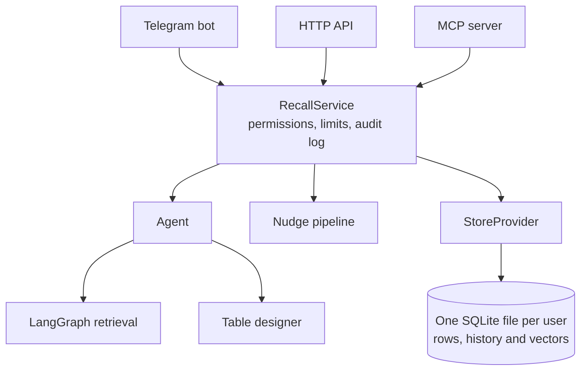

# Recall

Text it anything. It remembers, organizes it, answers with sources, and speaks up before you forget.

Recall is a personal memory that lives in a Telegram chat. Messy messages and receipt photos become
structured records in tables the AI designs itself. Ask a question and you get an answer with the
saved entries behind it. Leave something unfinished and Recall messages you first.

| You send | Recall does |
| --- | --- |
| `Watched Dune 2 with Arjun, 9/10` | Creates a `movies` table and saves a row, with the genre filled in |
| A photo of a receipt | Saves each item as a row, and tells you the total |
| `How much did I spend on food this week?` | Runs SQL for the sum, then shows the entries it used |
| `Who owes me money?` | Finds "lent Arjun 2000" by meaning, even without the word "owes" |
| `Told Maya I'd send the photos` | Saves the promise and asks when to remind you |
| Nothing | Two weeks later: "You still need to send Maya the photos" |

The same memory also works in other AI tools. Over MCP, Claude Code can answer "what did I promise
Maya?" from your Telegram notes.

## Why I built this

Useful facts get lost across chats, notes and receipts, and they surface too late, if at all. Chat
assistants with memory wait to be asked and can't be checked. Recall aims for three things they
don't do by default: exact answers from real data, sources you can verify, and speaking up first.

Telegram means there's no app to install, and saving something takes one message.

## Quick start

You need:

- [uv](https://docs.astral.sh/uv/), which installs the right Python for you
- An [Anthropic API key](https://console.anthropic.com/)
- A bot token from [@BotFather](https://t.me/BotFather)
- Your numeric Telegram user ID, from [@userinfobot](https://t.me/userinfobot)

```sh
git clone https://github.com/KeertanaSG/recall.git
cd recall
uv sync
cp .env.example .env    # then fill in the three required values
uv run recall
```

When you see `Application started`, open your bot in Telegram and send `/start`. The first search
downloads a small embedding model to `data/models/`. Logs go to the terminal and `data/logs/bot.log`.

To try it with sample data, stop the bot and run `uv run recall-demo`, which adds 36 backdated
entries with no model calls. Then send `/nudge` or `Tell me about Arjun`. Use `--fresh` to back up and
replace existing memory.

Run the tests with `uv run pytest`. They need no network or API keys.

## Architecture



Every client goes through `RecallService`, so permission checks live in one place and no client
touches a database directly.

```
src/recall/
  channels/   Telegram, HTTP API and MCP server: thin layers over the service
  core/       Product logic: agent, tools, retrieval, table design, nudges, reminder rules
  llm/        base.py is the interface, claude.py is the provider
  storage/    base.py is the interface, store.py is SQLite, embeddings.py is local embeddings
  service.py  The one path to a user's memory
  factory.py  The one place that chooses implementations
  auth.py     API tokens, scopes, rate limits and the audit log
```

`core` depends only on the interfaces, so it never imports Anthropic, Telegram or SQLite.
[`tests/test_architecture.py`](tests/test_architecture.py) enforces this, and runs the agent on a
second, fake provider with a different message format to prove the seam works.

### Swapping parts

| To change | Implement | Then |
| --- | --- | --- |
| The LLM provider | `LLM` in [`llm/base.py`](src/recall/llm/base.py) | Register it in [`factory.py`](src/recall/factory.py) and set `RECALL_LLM_PROVIDER` |
| The models | Nothing | Set `RECALL_MODEL`, `RECALL_RETRIEVAL_MODEL` or `RECALL_DESIGN_MODEL` |
| The embedder | `Embedder` in [`storage/embeddings.py`](src/recall/storage/embeddings.py) | Register it and set `RECALL_EMBEDDER` |
| The database | `MemoryStore` and `StoreProvider` in [`storage/base.py`](src/recall/storage/base.py) | Register it and set `RECALL_STORAGE` |
| The chat app | A new file in `channels/`, calling `RecallService` | Add a start command |

Only Claude, local embeddings and SQLite exist today. A new provider also has to pass the evals,
because prompts are tuned for the current models. Embeddings are stored at a fixed size of 384, so a
new embedder with a different size needs a re-embed.

### How the main features work

**Agent-designed tables.** Opus designs each new table for its whole subject, with required and
optional columns, and duplicates like `coffee` and `coffee_log` are refused. New details arrive
through `add_column`. Nothing is written for a specific subject, so movies, loans and gift ideas all
take the same path.

**Two kinds of answers.** Totals and filters go through read-only SQL, so the arithmetic is exact.
Vague questions go through a LangGraph pipeline that widens the question, merges semantic and keyword
matches with reciprocal rank fusion, and grades the results. Grading is what lets Recall say it found
nothing rather than guess.

**Answers you can check.** The model cites rows as `[table#id]`. Recall looks up each one and prints
the stored row, so sources come from the database, not the model. A citation that doesn't resolve
shows a warning.

**Smart nudges.** A four-stage pipeline keeps this cheap and quiet:

1. **Detect:** yes/no columns like `repaid`, plus local search, find open items in any table. No
   model call.
2. **Judge:** Haiku sees only those candidates, along with any later entries that might show they're
   resolved. It drops anything finished, trivial or sensitive.
3. **Policy:** picks become normal reminders, so quiet hours, daily limits, mutes and pause all apply.
4. **Deliver:** at most two per scan, each with its source and Done, Snooze and Stop buttons.

**Person briefs.** Ask "tell me about Arjun" and the `about` tool gathers every entry naming Arjun,
across all tables, with each table's purpose and your original words. The reply leads with what's
still open and links the rest.

**Photo capture.** A photo goes through the normal agent turn, using the same saving tools as text.
Receipt items become separate rows, and the total stays out of the table so sums come out right. The
photo itself is never stored.

## Results

Both evals use synthetic data with real Claude calls, and results are saved in
[`evals/results/`](evals/results/).

**Retrieval:** a 5,524-row history with 34 questions.

| Setup | Answerable questions | Nothing-saved questions |
| --- | --- | --- |
| Plain vector search | 21/24 | 0/10 |
| Recall's hybrid search, 2 runs | 47/48 | 18/20 |
| Hybrid with local search first, the default | 24/24 | 9/10 |

Searching locally before the first model call cut the median answer from about 4.8 seconds to 2.8.
Plain vector search and the first hybrid row come from earlier runs, and all of these used about
0.06 cents per question or less.

**Nudges:** 24 labelled rows with 7 truly open items, over 3 runs.

| Measure | Result |
| --- | --- |
| Open items found by the free detector | 7 of 7 |
| Precision | 100%, no false alarms |
| Recall | 6 of 7 |

This set is small, so treat it as an early check. Precision matters most here, because every false
alarm teaches someone to mute Recall.

```sh
uv run python evals/run_retrieval.py --agent
uv run python evals/compare.py
uv run python evals/run_nudges.py
```

These call the Anthropic API and need a filled-in `.env`.

## Key decisions

| Decision | Why | Trade-off |
| --- | --- | --- |
| Haiku for most steps, Opus only for table design | Tables outlive the message that created them, and everything else needs to be cheap | Saves that create a table are slower |
| One SQLite file per user | Free, fast, strong isolation, and `/export` and delete stay simple | Limited to one server. `MemoryStore` keeps a move to Postgres contained |
| Interfaces only where swapping is realistic | The LLM, embedder, storage and channels can change without touching product logic | A little more code, and only one real implementation of each so far |
| Local embeddings | No API cost, and note text isn't sent to an embedding provider | Adds memory use to each process |
| Hosted models over a local LLM | A local Qwen3 benchmark stalled for hours | Message text goes to Anthropic |
| No delete tool for the agent | Text inside a saved note can't trigger a delete, because deleting takes a tap | Bulk delete needs its own flow |
| `remember` can only add | A write-only token must not be able to read or change memory through the agent | Corrections only work on Telegram |
| Disk encryption before SQLCipher | It covers the main risk, a stolen disk, without key management | Copied files stay readable on a running server |

## Using it from other apps

The HTTP API and MCP server use the same memory. Both listen on localhost.

Create a token first. Only a hash is stored, so copy it when it's shown.

```sh
uv run recall-tokens create --user <telegram-id> --name claude-code --scopes read,write --days 30
uv run recall-tokens list
uv run recall-tokens revoke <id>
```

**MCP in Claude Code:**

```sh
claude mcp add --transport stdio --env RECALL_TOKEN=<token> recall -- uv run --directory "$PWD" recall-mcp
```

Tools: `search_memory`, `about`, `query_memory`, `list_tables`, `get_entry`, `list_reminders`,
`remember` and `set_reminder`. None of them can delete anything. For HTTP, run `uv run recall-mcp --http`, which
listens on port 8788.

**HTTP API:**

```sh
uv run recall-api    # port 8787

curl -X POST http://127.0.0.1:8787/v1/search \
  -H "Authorization: Bearer <token>" -H "Content-Type: application/json" \
  -d '{"text": "who owes me money"}'
```

| Route | Scope |
| --- | --- |
| `POST /v1/search`, `POST /v1/query`, `GET /v1/about/{name}` | read |
| `GET /v1/tables`, `GET /v1/entries/{table}/{id}`, `GET /v1/reminders` | read |
| `POST /v1/remember`, `POST /v1/reminders` | write |

## Bot commands

| Command | What it does |
| --- | --- |
| `/nudge` | Check for unfinished business now |
| `/undo` | Reverse the last save |
| `/forget <words>` | Find an entry, page through matches, and erase it for good after a tap |
| `/export` | Download everything as CSV files in a zip |
| `/delete_all` | Erase everything, after a tap |
| `/timezone <Area/City>` | Set your time zone |
| `/quiet 22:00 08:00`, `/quiet off` | Set quiet hours |
| `/pause`, `/resume` | Hold or restart proactive messages |
| `/unmute <kind>` | Turn a reminder type back on |

## Security and privacy

- **Isolation:** each user has their own database, and a caller's user always comes from a verified
  identity, never from a request.
- **Tokens:** stored only as hashes, with scopes, expiry and instant revocation. Audit logs never
  contain memory text.
- **Limited agent:** it has no delete tool, its SQL runs on a separate read-only connection, and text
  inside saved rows is treated as data.
- **Spending:** daily limits, 30 messages per user and 300 in total by default, hold across all
  processes. `ALLOWED_USER_IDS` controls who can use the bot, and `*` opens it to anyone.

Database files aren't encrypted by Recall itself. Message text passes through Telegram and Anthropic,
and Telegram bot chats aren't end-to-end encrypted. Don't save passwords, bank details or medical
records.

## Limitations

- The injection and concurrent-write tests are still to come.
- Evals use synthetic data, and photo capture has mostly been tested on a generated receipt.
- A save that creates a new table can take 10 to 20 seconds.
- English only.
- It runs locally. The API and MCP server need HTTPS in front before they're exposed.

## What's next

The full plan is in [docs/ROADMAP.md](docs/ROADMAP.md), and the original product thinking is in
[docs/PRD.md](docs/PRD.md). The next steps are a small server with encrypted backups, then larger
evals and a trained local reranker to cut model costs.
