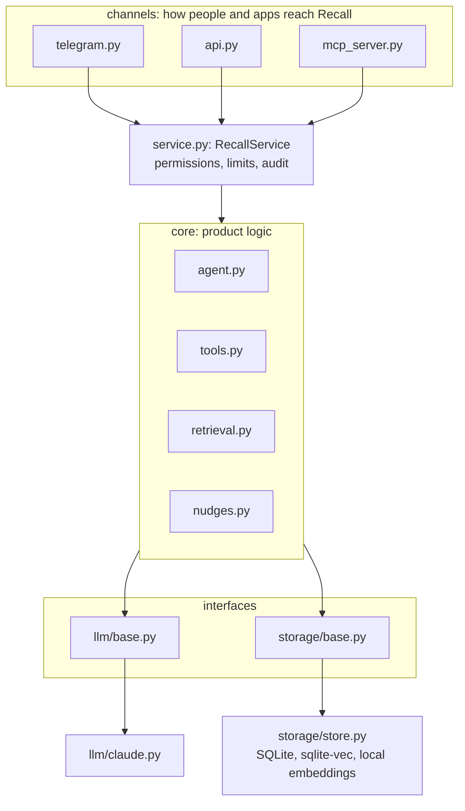
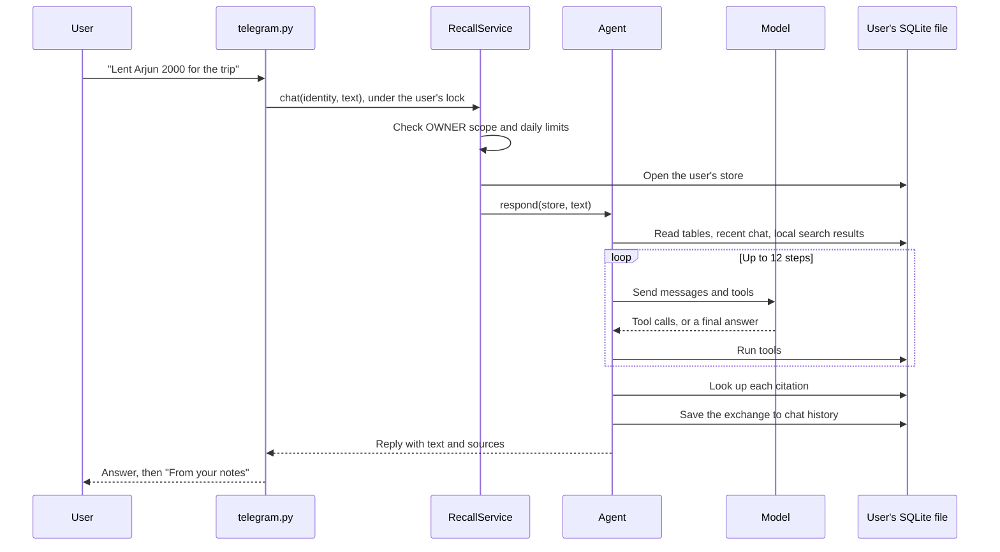
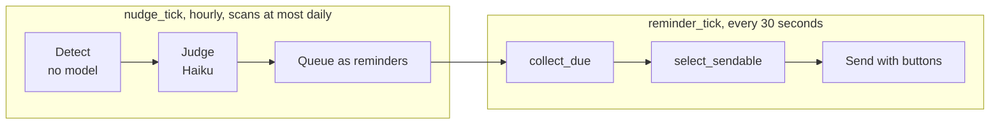

# Recall: Architecture

How the code is organized and how a message moves through it. For why it's built this way, see
[DESIGN.md](DESIGN.md). For setup and commands, see the [README](../README.md).

## The system at a glance

Recall has three entry points, and they all share one service layer. Each user's memory is a single
SQLite file.

Dependencies point one way:

- **Channels** turn a Telegram update, HTTP request or MCP call into a service call. They hold no
  product rules.
- **The service** decides who may do what, then opens that user's store.
- **Core** holds the product logic and only knows the interfaces. It never imports Anthropic,
  Telegram or SQLite.
- **`factory.py`** is the only place that chooses implementations.

[`tests/test_architecture.py`](../tests/test_architecture.py) reads the imports of each file and
fails if a boundary is crossed, so these rules can't quietly erode.

## Code map

| Path | Job | Read it when |
| --- | --- | --- |
| [`service.py`](../src/recall/service.py) | The one door to a user's memory | You want to see every operation Recall offers |
| [`factory.py`](../src/recall/factory.py) | Builds the service from settings | You're adding a provider |
| [`core/agent.py`](../src/recall/core/agent.py) | The model loop, chat and add-only turns, citations | You're changing how a turn runs |
| [`core/tools.py`](../src/recall/core/tools.py) | Tool schemas, their handlers, the table designer | You're adding something the agent can do |
| [`core/retrieval.py`](../src/recall/core/retrieval.py) | Hybrid search and the LangGraph pipeline | You're changing search quality |
| [`core/nudges.py`](../src/recall/core/nudges.py) | The nudge pipeline and the reminder rules | You're changing what gets sent unasked |
| [`llm/base.py`](../src/recall/llm/base.py) | The `LLM` interface | You're adding a model provider |
| [`llm/claude.py`](../src/recall/llm/claude.py) | Everything specific to Anthropic's API | You're changing how Claude is called |
| [`storage/base.py`](../src/recall/storage/base.py) | The `MemoryStore`, `StoreProvider` and `Embedder` interfaces | You're adding a database |
| [`storage/store.py`](../src/recall/storage/store.py) | SQLite, history, undo, search, reminders, export | You're changing what's stored |
| [`channels/telegram.py`](../src/recall/channels/telegram.py) | Commands, buttons, photos, scheduled delivery | You're changing the bot |
| [`channels/api.py`](../src/recall/channels/api.py) | The HTTP routes | You're changing the API |
| [`channels/mcp_server.py`](../src/recall/channels/mcp_server.py) | The eight MCP tools | You're changing what other AI apps see |
| [`access.py`](../src/recall/access.py) | Tokens, scopes, audit log, rate and daily limits | You're changing permissions |
| [`logs.py`](../src/recall/logs.py) | Structured JSON events | You're adding logging |
| [`prompts/`](../src/recall/prompts/) | Every prompt, as named Jinja blocks | You're changing what the model is told |
| [`cli.py`](../src/recall/cli.py) | `recall-tokens` and `recall-demo` | You're managing tokens or seeding data |
| [`config.py`](../src/recall/config.py) | Settings from the environment | You're adding a setting |

A good reading order is `service.py`, then `core/agent.py`, then `core/tools.py`. That covers most of
the system.

## What happens to a message

### A chat turn on Telegram

The steps worth knowing:

1. **Identity.** The bot builds an identity from Telegram's verified user ID. No service method takes
   a user ID, so a caller can't ask for someone else's data.
2. **Context.** The agent builds the current time, a 14-day calendar and the list of tables. This is
   how "next Friday" resolves correctly.
3. **Search first.** `prefetched_entries` runs a free local search and adds the results to the
   message, so a simple question often needs no search tool.
4. **The loop.** `Agent._run` calls the model and runs its tools until it gives a final answer. A
   `ToolError` goes back to the model as a tool result, so it can correct itself.
5. **Citations.** The model writes `[table#id]`, and `resolve_citations` replaces each one with the
   row read from the database. A citation that doesn't resolve adds a warning to the reply.
6. **Failure.** Any failure in the loop undoes the turn's writes and raises `TurnFailed`, so the user
   never gets a half-saved message.

### A vague question

The agent's `search` tool runs a three-step LangGraph pipeline in
[`retrieval.py`](../src/recall/core/retrieval.py):

| Step | What it does | Model |
| --- | --- | --- |
| Plan | Widens the question into search phrases and keywords | Haiku |
| Retrieve | Runs semantic and keyword searches, then merges them with reciprocal rank fusion | None |
| Grade | Keeps only the rows that help answer the question | Haiku |

If a model step fails, search still works with less filtering. The result reports
`filtered_for_relevance: false` so the agent knows the rows weren't graded.

### An exact question

Totals and filters go through the `query` tool, which calls `Store.read_query`. It opens a separate
read-only connection, and adds an authorizer that blocks everything except reads of the user's own
tables, plus a 2-second limit and a 200-row cap.

### A save from another app

`remember` runs `Agent.capture`, which differs from a chat turn on purpose:

- It only gets `create_table`, `add_column`, `add_row` and `set_reminder`.
- It gets no chat history, no search and no prefetch.
- Its reply is thrown away, and the caller only gets the IDs of what was added.
- It stays out of chat history, so outside text is never replayed as something the user said.

### Reminders and nudges

Both are driven by jobs in the bot process. They run a user at a time, and skip anyone with a turn
in progress.

Reminders the user asked for always fire on time. Proactive ones stay pending while pause, quiet
hours, a muted kind or the daily limit applies, so the next allowed tick sends them. Nudges are
ordinary reminders with the kind `nudge`, so every one of these rules applies to them too.

## Data

### Files on disk

Everything lives under `data/`, which git ignores.

| Path | Holds |
| --- | --- |
| `users/<telegram-id>.sqlite` | One user's whole memory |
| `auth.sqlite` | Hashed API tokens and the audit log |
| `usage.sqlite` | Daily message counts, shared across processes |
| `models/` | The downloaded embedding model |
| `logs/` | `bot.jsonl`, `api.jsonl` and `mcp.jsonl` |

### Inside a user's file

The agent creates the user's own tables, such as `loans` or `movies`, and each one gets `id`,
`source_text`, `created_at` and `updated_at`. Internal tables start with an underscore.

| Table | Purpose |
| --- | --- |
| `_tables`, `_columns` | Descriptions of the user's tables, so the agent knows what each one means |
| `_turns`, `_history` | Every change with old and new values, which powers undo and corrections |
| `_embeddings` | Which rows have a current vector, and which are waiting for one |
| `_vectors` | 384-dimension vectors, in a sqlite-vec table |
| `_messages` | The last 12 messages of chat context |
| `_settings` | Time zone, quiet hours, pause, muted kinds, last nudge scan |
| `_reminders` | Every reminder and nudge, with an optional link to its entry |

The agent's SQL can read the user's tables and `_reminders`. Every other internal table is blocked.

## Concurrency

The bot, API and MCP server are separate processes that can touch the same file.

- **Between processes:** WAL mode and `BEGIN IMMEDIATE` transactions. A write waits up to 10 seconds,
  then fails with a message the agent can act on.
- **Inside the bot:** one `asyncio.Lock` per user keeps turns in order, and blocking work runs in a
  thread so one slow turn doesn't stop the others.
- **Daily limits:** counted in `usage.sqlite`, so they hold across all three processes.

[`tests/test_concurrency.py`](../tests/test_concurrency.py) uses real processes to check that no
writes are lost.

## Failure handling

Errors are only caught where they would otherwise cause real harm.

| What fails | What happens |
| --- | --- |
| A tool call | The model sees the error as a tool result and can retry |
| Any step of a turn | The turn's writes are undone, and the user is told nothing was saved |
| Saving chat history after a good turn | Logged. The reply still goes out, so nobody resends a saved message |
| Embeddings | The row is saved and marked stale, then retried on a later tick. Keyword search still works |
| A search model step | Search continues with less filtering |
| The nudge judge | The scan isn't stamped, so the next tick tries again |
| One user's reminders | Logged. Other users' reminders continue |
| The audit log | Logged. It never replaces the request's own result |

## Logging

`logs.py` writes one JSON event per line. `bind` attaches a user reference, channel and turn ID to
everything inside a block. `measured` times a block and records its outcome. `count` and `add` roll
tokens and tool names up into the `turn` event.

Logs carry IDs, counts and timings, never memory text. Exception messages are dropped too, because
they can quote saved values.

## Tests and evals

| Kind | Where | Needs a key | Answers |
| --- | --- | --- | --- |
| Unit and edge tests | `tests/` | No | Does the code do what it says? |
| Boundary tests | `tests/test_architecture.py` | No | Are the layers still separate, and does a second provider work? |
| Concurrency test | `tests/test_concurrency.py` | No | Do writes survive several real processes? |
| Retrieval eval | `evals/run_retrieval.py` | Yes | Does search find the right rows, and stay quiet when it should? |
| Nudge eval | `evals/run_nudges.py` | Yes | Are nudges precise, and how many are missed? |
| Injection eval | `evals/run_injection.py` | Yes | Does the agent resist orders hidden in saved text? |

`uv run pytest` fails if line or branch coverage drops below 100%. Evals cost money, so they only run
by hand, and their results are saved in [`evals/results/`](../evals/results/).

## Common changes

To swap a provider, model, embedder or database, see
[Swapping parts](../README.md#swapping-parts) in the README.

| To add | Change |
| --- | --- |
| Something the agent can do | Add a schema to `TOOLS` and a `_name` method on `Tools` in `core/tools.py`. Add its storage method to `MemoryStore` and `Store` if it needs one |
| An operation for other apps | Add a method to `RecallService` using `self.access(...)` with the right scope, then expose it in `api.py` and `mcp_server.py` |
| A bot command | Add a handler in `channels/telegram.py`, wrap it in `allowed_only`, and register it in the app setup |
| A prompt change | Edit the block in `prompts/`, then rerun the evals |
| A setting | Add it to `Settings` in `config.py` and to `.env.example` |
| A reminder rule | Change `select_sendable` in `core/nudges.py` |
