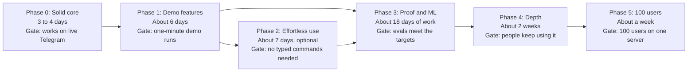

# Recall: Features and Roadmap

Last updated: 2026-11-02

## Summary

Recall is a Telegram memory that saves anything you text it, answers with sources, and speaks up
before you forget. The core product and three demo features are built and run locally. This doc
records what exists, how it was tested, and what would come next.

Every decision is judged on four goals: accuracy, speed, cost and scale. When they conflict,
accuracy wins, because one confident wrong answer breaks trust. Fixes stay general, with no rules
written for one subject or example.

## Goals

Recall meets its cost and speed goals on a synthetic benchmark. Saves that create a new table can
run over 10 seconds, and real use and scale are not yet proven.

| Goal | Target | Today | How we get there |
| --- | --- | --- | --- |
| Accuracy | At least 95% on realistic evals, by subject | 24/24 answerable and 9/10 nothing-saved with search-first, on synthetic data | Subject-by-subject evals, graded retrieval, citations read from the database |
| Speed | Saves under 10 seconds, answers under 5 seconds | 2.8 second median answer; saves 1.9 to 5.2 seconds, up to about 20 with a new table | Search-first retrieval, which cut the median from about 4.8 seconds |
| Cost | Under 0.1 cents per message | About 0.06 cents per question | Haiku for most steps, Opus only for table design, local embeddings |
| Scale | 100 users on one server, with a path to 1,000 | Estimated $16 a month in model costs at 100 users, untested | One file per user, then the Phase 5 fixes |

The targets are proposals, and the 95% figure should be confirmed after the first subject evals.

## Built today

The core product exists and has 221 passing automated tests. Its first full live Telegram test
passed on 2026-11-02.

| Feature | What it does | Tested with |
| --- | --- | --- |
| Capture | Saves any plain text into typed tables, with details like genre filled in | Real Claude, sample messages |
| Table design | Opus designs each new subject, with required and optional columns | Real Claude, sample messages |
| Duplicate table guard | Stops `coffee` and `coffee_log` from both existing | Automated tests |
| Exact answers | Runs read-only SQL for totals and filters | Real Claude, sample messages |
| Vague answers | LangGraph search plans, retrieves, grades and reports when nothing fits | Real Claude, 5,524-row benchmark |
| Sources | Shows saved entries read from the database, and warns on a bad citation | Real Claude, automated tests |
| Corrections | Updates a fact and keeps the old value in history | Real Claude, sample messages |
| Reminders | Finds dates, asks when none is given, and links the reminder to its entry | Real Claude, automated tests |
| Personal patterns | Remembers what helps in a mood or situation, and brings it up later | Real Claude, sample messages |
| Controls | `/undo`, `/forget`, `/export`, `/delete_all`, quiet hours, pause | Automated tests for storage, not the Telegram commands |
| Natural replies | Sounds like a friend texting back | Real Claude, 57 replies including unseen messages |
| Daily limits | Caps messages per user and in total, across all processes | Automated tests |
| One service layer | The bot, API and MCP server all reach memory through `RecallService` | Automated tests |
| API tokens | Hashed tokens with read and write scopes, expiry, revocation and an audit log | Automated tests, local end-to-end run |
| HTTP API | Search, read-only SQL, entries, reminders and saving, on localhost | Automated tests, local end-to-end run |
| MCP server | Eight tools over stdio or HTTP, with no delete tool | Automated tests, local end-to-end run |
| Smart nudges | Texts first about unfinished business, using a free detector, then a Haiku judge, then the reminder rules | Real Claude, labelled eval, automated tests |
| Photo capture | Turns a photo into rows, with each receipt item saved separately. The photo is never stored | Real Claude with a generated receipt, automated tests |
| Person briefs | Gathers everything about a name across tables into one connected answer | Real Claude on demo data |
| Demo seed | `recall-demo` adds 36 backdated entries with no model calls | Automated tests, real run |
| Swappable parts | LLM, embedder, storage and channels sit behind interfaces, chosen in `factory.py` | Automated boundary tests, a fake second provider |
| Structured logs | JSON events per process with turn IDs, timings and token totals, and no memory text | Real Claude across all three processes, automated tests |
| Add-only saving | `remember` from other apps can only add, can't read, and returns only new entry IDs | Real Claude, automated tests |

Search-first retrieval is on by default, and scored 24/24 and 9/10 with a 2.8 second median. Crisis
replies point to trusted people and local services, and never include a phone number the model
can't check.

## Demo features

Three features make the demo, because each shows something a chat assistant with memory doesn't do by
default. Smart nudges, photo capture and person briefs are built. Efforts are rough estimates.

| Feature | Demo moment | Shows | Effort |
| --- | --- | --- | --- |
| Smart nudges | Recall messages first: "Arjun still owes you ₹2000 from last month" | Proactive | 2 to 3 days |
| Person brief | "Tell me about Arjun" connects a loan, a movie and a fact, with sources | Connected and inspectable | 2 days |
| Photo capture | Send a receipt, and the items and total become real rows | Effortless capture | 1 to 2 days |

Together they form the one-minute demo: send a receipt, ask about a person, then watch Recall
speak up on its own.

## Roadmap

Phases 0 and 1 are largely done. Each phase ends with a gate that must pass before the next starts,
and Phases 4 and 5 only happen if real people keep using Recall.

Phase 2 can move after Phase 3 if time runs short, since it isn't needed for the demo.

## All planned features

Each item serves at least one of the four goals and works for any subject. Efforts are rough
estimates.

| Phase | Item | Goal served | How it stays general | Effort |
| --- | --- | --- | --- | --- |
| 0 | Live Telegram test (done 2026-11-02) | Accuracy | Tests every flow in real chats | 1 day |
| 0 | Search-first on by default (done) | Speed, cost | Runs free local search before any model call | 1 day |
| 0 | Bot command and button tests | Accuracy | Covers all handlers | 1 day |
| 0 | Safe failure replies | Accuracy | Every failed turn gets a useful reply | Half a day |
| 0 | `/forget` at scale (done) | Accuracy | Uses hybrid search, drops weak matches, shows dates, and pages through results in any table | 1 day |
| 0 | Short source summaries (done) | Speed | When "From your notes" gets too long, any answer shows a summary instead of the full list | Half a day |
| 0 | Deploy to a small server | Scale | Reminders stop depending on a laptop | Half a day |
| 1 | Smart nudges (done) | Accuracy | Finds open items that have gone quiet in any table | 2 to 3 days |
| 1 | Person brief (done) | Accuracy | Gathers a name across all tables | 2 days |
| 1 | Photo capture (done) | Speed | Images go through the same saving tools as text | 1 to 2 days |
| 2 | Natural commands | Speed | Agent tools for undo, settings and forget, with deletes needing a tap | 2 days |
| 2 | Bulk forget | Accuracy | "Forget all cabs from March" shows a count and a preview, then needs a tap | 1 day |
| 2 | Charts | Accuracy | Plots SQL results from any table | 1 to 2 days |
| 2 | Voice notes | Speed | Speech becomes a normal message | 1 to 2 days |
| 2 | Weekly digest | Accuracy | Summarizes the week from every table | 1 to 2 days |
| 3 | Subject-by-subject evals | Accuracy | Scores saves, tables, corrections, reminders and answers | 3 days |
| 3 | Retrieval evaluation suite | Accuracy | Reports recall@k, MRR, nDCG and confidence intervals for any search setup | 2 to 3 days |
| 3 | Trained relevance reranker | Speed, cost | A fine-tuned local model grades any row, with Haiku kept as the baseline | 1 week |
| 3 | Message router | Speed, cost | A small classifier sorts messages by intent before any LLM call | 3 to 4 days |
| 3 | Abstention calibration | Accuracy | Learns when to say nothing was found, at a chosen false-answer rate | 2 to 3 days |
| 3 | One week of real use | Accuracy | Tests habit and real messages, with 2 or 3 testers after | 1 week |
| 3 | Write-up, demo video, public repo | Accuracy | Publishes results, including the baseline comparison | 2 days |
| 4 | Read-only web view | Accuracy | Lets people inspect any table and its history | 3 to 4 days |
| 4 | Remote MCP | Scale | Adds login so any device can connect | 3 to 5 days |
| 4 | Learned nudge ranking | Accuracy | A contextual bandit learns from done, snooze and stop | 1 week |
| 4 | Entity resolution model | Accuracy | A pairwise model and clustering match names across tables | 1 week |
| 4 | Recurring and anomaly detection | Accuracy | Time-series methods find repeats and unusual values in any numeric table | 3 to 4 days |
| 5 | Invite codes | Scale | Adds users without a restart | 1 day |
| 5 | Durable message inbox | Accuracy | Keeps messages through outages | 1 day |
| 5 | Encrypted nightly backups | Scale | Protects every user's file | 1 day |
| 5 | Alerts and cost per user | Cost | Makes problems and spending visible | 1 day |
| 5 | Privacy policy and disk encryption | Scale | Prepares for users who don't know the operator | 1 day |
| 5 | Central reminder index | Scale | Opens only the files with a reminder due | 1 day |
| 5 | SQLCipher, once tested with `sqlite-vec` | Scale | Encrypts every user's file, with keys kept off the data disk | 2 to 3 days |

## Hardening plan

This work makes Recall secure, scalable, modular, cheap and accurate, alongside the phases above.
Efforts are rough estimates.

| Step | Work | Effort | Status |
| --- | --- | --- | --- |
| 1 | Fix the base: add-only `remember`, limits across processes, one service layer | 2 days | Done |
| 2 | Prove it: bot handler tests, concurrent write test, injection and cross-user tests, bot logs saved to a file, Live Telegram test is done | 3 days | In progress |
| 3 | Faster and cheaper: search-first, one shared embedding service, cost per user | 3 days | Planned |
| 4 | Accuracy: subject evals, retrieval metrics, a larger test set, checked crisis numbers | 5 days | Planned |
| 5 | Deploy securely: disk encryption, HTTPS, encrypted backups, alerts | 3 days | Planned |
| 6 | Scale to 100 users: Phase 5 items, OAuth for remote MCP, a load test | 3 days | Waits for real users |

Rate limits apply per token for now. A per-user limit was left out on purpose, so a user with several
tokens gets the limit on each one.

## ML projects

These show model training, evaluation and experiment design, and each one aims to make Recall
faster or cheaper. The retrieval evaluation suite comes first, because the other projects need its
metrics to prove anything.

- **Data:** the 34 benchmark questions are too few to train on, so training examples will be generated
  and labelled. Test data must be written separately, so results aren't inflated.
- **Baselines:** Haiku grading stays available, so every comparison is fair. A model that loses to
  Haiku is still a valid result if it's reported honestly.
- **Real data:** nudge ranking, entity resolution and pattern insights wait for real use, because
  they can't be judged on synthetic histories.

## Future use

These stay parked until real use shows they're worth the cost.

| Feature | Why it waits |
| --- | --- |
| Mood logging and pattern insights | Sensitive, opt-in only, and needs weeks of real data. Results must show uncertainty and avoid claiming cause |
| Recommendations from history | Only useful once histories are long |
| Google Calendar and Gmail import | Adds privacy and approval work |
| Other languages | English only is the current decision |
| Cheaper or open models | Haiku is already close to the cheapest, and a local Qwen3 test was much slower |
| WhatsApp or iMessage | WhatsApp policy and fees, and no official iMessage bot API |
| Shared memories | Non-goal in the PRD |
| Hosted Postgres with pgvector | One SQLite file per user is the current decision. Move when Recall needs more than one server, which means a new `MemoryStore` and `StoreProvider` |
| Scale past 1,000 users | Needs webhooks, separate workers and storage shards |

Passive recording of calls, screens or conversations stays out for good, as do passwords, bank
details and medical records.

## Open decisions

- [ ] Are the goal targets in this doc right, especially 95% accuracy?
